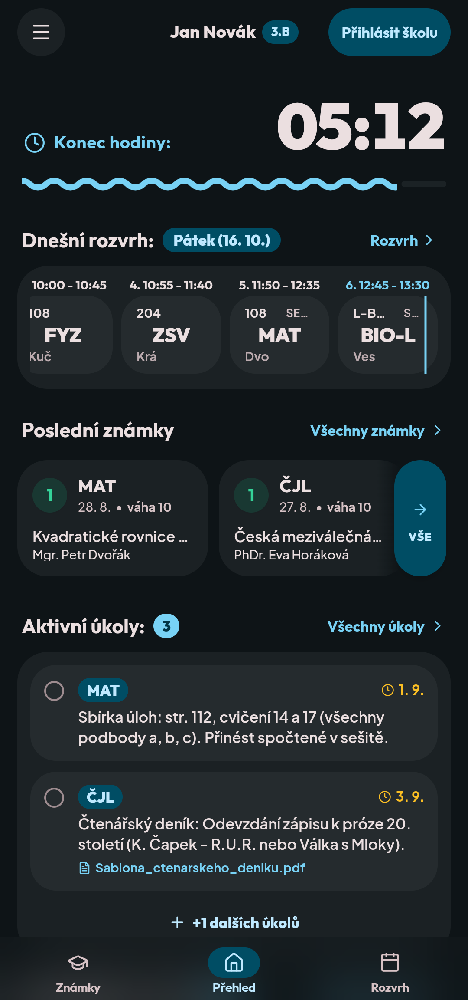
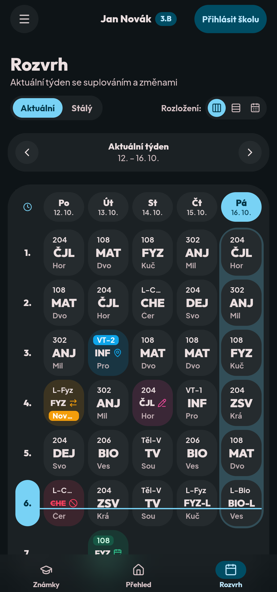
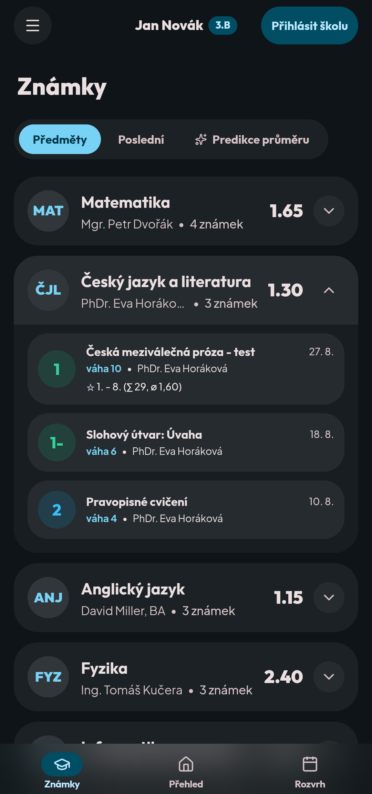
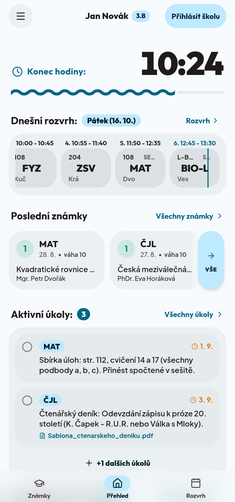
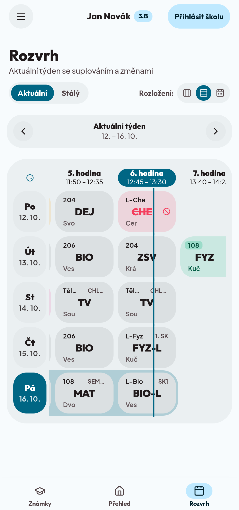
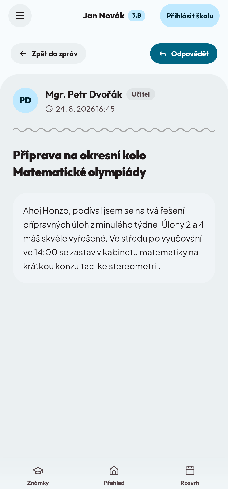

# Magistři

A modern, lightning-fast, lightweight alternative unofficial client for the
Bakaláři school management system. Magistři is available in Czech and English
as an Android app and an installable web app. Demo mode lets you explore it
without a school account.

## Screenshots

<div align="center">
  
  
  
  <br />
  
  
  
</div>

## Features and architecture

- See grades, a weighted-average predictor, timetables, substitutions, and absence records.
- Read and send Komens messages and view homework, attachments, and school events.
- Customize the dashboard, colors, and dark mode. Android also supports Material You wallpaper colors, home-screen widgets, and local notifications from background sync.

The web app uses React and TypeScript. The Android app uses Capacitor with
native Kotlin integrations.

## Android

Download the signed APK and its SHA-256 checksum from
[GitHub Releases](https://github.com/IvyCZE/Magistri/releases). For development,
use JDK 21 and Android SDK 36. See [Android build and release instructions](ANDROID_UPDATE.md).

## Local development

Use Node.js 22.12+ on the 22.x release line, Node.js 24.x, or Node.js 26 or
later. The `.nvmrc` selects Node.js 22.

```sh
git clone https://github.com/IvyCZE/Magistri.git
cd Magistri
npm ci
npm run dev
```

Open [http://localhost:3000](http://localhost:3000). Run `npm test` for the
web and proxy tests and `npm run build` for the production build.
[CONTRIBUTING.md](CONTRIBUTING.md) covers fixture and validation conventions.

## Self-host the web app

```sh
docker compose up -d --build
```

The web app listens on port 8080 with the supplied Compose file. For an
internet-facing deployment, put HTTPS termination in front of the container
and follow the [deployment security notes](deploy/SECURITY.md). The supplied
image includes the school API proxy.

## Privacy and security

Android normally connects directly to the selected school. The web app
forwards school requests through its hosting proxy, which can see credentials,
tokens, and school responses while forwarding them. A configured custom
proxy also handles those requests.

See the [privacy policy](https://storage.ivy.yt/vistaria/privacypolicy),
[security reporting instructions](SECURITY.md), and
[threat model](SECURITY_MODEL.md).

## License

Magistři source code and project artwork are licensed under
[GPL-3.0-only](LICENSE). See [NOTICE](NOTICE) for project attribution and
[THIRD_PARTY_NOTICES.md](THIRD_PARTY_NOTICES.md) for dependency notices.
